## Deep Learning Basics

### Data-driven approaches

- Procedure
  1. Collect a dataset of images and labels
  2. Use Machine Learning algorithms to train a classifier
  3. Evaluate the classifier on new images
- 2 popular methods: Nearest Neighbor Classifier, linear classification

### K-Nearest Neighbor

```python
def train(images, labels):
    # Machine learning!
    return model

def predict(model, test_images):
    # Use model to predict labels
    return test_labels
```

The pattern is that given training data with labels and query data, you should calculate the similarity of them. There are many ways of doing that, such as L1 distance and L2 distance.

- Q: With N examples, how fast are training and prediction? A: Train O(1), predict O(N). -- That's bad. We want classifiers that are fast at prediction and slow for training.

- Difference between L1 and L2: it's better to use L1 (sensitive to features) if our features are very specific and meaningful and we want to preserve their information because it has a shape that preserves and enforces distances based on the features. (Key: Rotation of axles)
- Tips
  - When the training data is small, you can use k-fold cross-validation and find the best k with grad-search.
  - k-Nearest Neighbor with pixel distance never used.

### Linear classification

### Loss Functions

#### Regularization

- L2 regularization: $R(W)=\sum_k\sum_lW_{k,l}^2$
- L1 regularization: $R(W)=\sum_k\sum_l|W_{k,l}|$, which will lead to get more 0 in W than L2 because square makes small value smaller, that's why L2 prefers spread out weights that are all small while L1 prefers sparse vectors.
- Elastic net (L1+L2): $R(W)=\sum_k\sum_l\beta W_{k,l}^2+|W_{k,l}|$
- Why regularize?
  - Express preferences over weights
  - Make the model simple so it works on test data
  - Improve optimization by adding curvature

### Optimization

- Stochastic Gradient Descent (SGD): use a batch data to update W instead of whole training data. "Stochastic" means the batch is a stochastic subset, but in practice people will assure to traverse the whole training data, which is called an "epoch".
- Problems with SGD
  - Very slow progress along shallow dimension, jitter along steep direction.
  - Saddle points much more common in high dimension.
  - Our gradients come from minibatches so they can be noisy.
- Optimizers
  - SGD: slower because moving in the fixed direction.
  - SGD+Momentum: pretend to overshoots but can come back.
  - RMSProp: larger steps in the flatter areas of your loss landscape and shorter steps in the very steep areas.
  - Adam: combination of SGD+Momentum and RMSProp. [Adam with beta1 = 0.9, beta2 = 0.999, and learning_rate = 1e-3 or 5e-4 is a great starting point for many models.]
  - AdamW
- Learning Rate Decay
  - Step: Reduce learning rate at a few fixed points. E. g. for ResNets, multiply LR by 0.1 after epochs 30, 60, and 90.
  - Cosine: $\alpha_t=\frac12\alpha_0(1+\cos(t\pi/T))$
  - Linear: $\alpha_t=\alpha_0(1-t/T)$
  - Inverse sqrt: $\alpha_t=\alpha_0/\sqrt{t}$
  - Linear Warmup
  - Empirical rule of thumb: If you increase the batch size by N, also scale the initial learning rate by N.
- Tip: If the model or the training data are not large, you can try to use second-order optimization, which is more complex.

### Backpropagation

This is an application of chain rule. First, the computer calculates the Forward Propagation and save intermediate variables. Then, in Backpropagation, the computer calls the variables to calculate the gradients.

### Multi-layer Perceptions

### Neural Networks

### Activation Functions

- Goal: Introduce non-linearities to our model.
- ReLU、Leaky ReLU、ELU、GELU、Sigmoid、Tanh、SiLU
- Sigmoid and Tanh: squash values in a narrow range resulting in vanishing gradients, so we don't use them in the middle of the neural networks. They are often used in the later layers, where we want to binarize the outputs.

### Data Augmentation

## Perceiving and Understanding the Visual World

### Transfer Learning

### Optimizers

### Convolutions

- The difference between designing a neural network and versus designing a feature extractor: in designing a neural network, you're not designing a particular function of a feature extractor. You're defining a whole category of functions, where the category of functions is defined by the structure of your computational graph, by the sequence of operators the get run.
- Anything built on **dot products** is basically a **template matching**. They are **filters**.
  - For Conv, filters always extend the full depth of the input volume.
  - Different filters have different initialization.
- Problem1: Feature maps shrink with each layer
  - Solution: Add padding around the input before sliding the filter, where $P=(K-1)/2$.

- Problem2: For large images we need many layers for each output to "see" the whole image.

  - Solution: **Downsample inside the network, which is stride.** Output: $(W-K+2P)/S+1$.

- **Pooling layers are another way to downsample.** We don't use padding in pooling. It's common to use (2*2, 2) pooling.

- Dropout: prevent the model to be too dependent on some features. 

  - We do not dropout in test time.

  - We must scale the activations so that for each neuron: <u>output at test time</u> = <u>expected output at training time</u>.

    ```python
    def predict(X):
        H1 = np.maximum(0, np.dot(W1, X) + b1) * p
        H2 = np.maximum(0, np.dot(W2, H1) + b2) * p
        out = np.dot(W3, H2) + b3
    ```

  - The weights associated with dropout will not be updated during gradient descent.

- CNN Archtecture

  - For VGGNet, why use smaller filters?
    - Stack of three $3\times3$ conv (stride 1) layers has same effective receptive field as one $7\times 7$ conv layer.
    - But deeper, more non-linearities.
    - And fewer parameters: 3 * ($3^2C^2$) vs. $7^2C^2$ for C channels per layer.
  - ResNet
    - Background: Deeper models are harder to optimize, are more likely to fall into local minimum.
    - Use layers to **learn residual** $F(x)=H(x)-x$ instead of $H(x)$ directly.

- Weights Initialization: Kaiming / MSRA Initialization

  Goal: To keep mean and std for all layers.

  ```python
  W = np.random.randn(Din, Dout) * np.sqrt(2/Din)
  ```

#### Training Techniques

- Data preprocessing

  - Requires pre-computing means and std for each pixel channel (given your dataset).
  - Subtract per-channel mean and divide by per-channel std (almost all modern models).

  ```python
  # Instance Normalization
  norm_pixel[i,j,c] = (pixel[i,j,c] - np.mean(pixel[:,:,c])) / np.std(pixel[:,:,c])
  
  # But in many times, we usually use global normalization
  global_mean = [0.485, 0.456, 0.406]
  global_std = [0.229, 0.224, 0.225]
  norm_pixel[i,j,c] = (pixel[i,j,c] - global_mean[c]) / global_std[c]
  ```

- Data Augmentation

  - Random crops and scales
    - Training: sample random crops / scales ResNet:
      1. Pick random L in range [256, 480]
      2. Resize training image, short side = L
      3. Sample random $224\times 224$ patch
    - Test Time Augmentation: average a fixed set of crops ResNet:
      1. Resize image at 5 scales: {224, 256, 384, 480, 640}
      2. For each size, use 10 $224\times 224$ crops: 4 corners + center, +flips

- Choosing Hyperparameters (Debug)

  - Step1: Check initial loss
  - Step2: Overfit a small sample
  - Step3: Find LR that makes loss go down

  Use the architecture from the previous step, use all training data, turn on small weight decay, find a learning rate that makes the loss drop significantly within ~100 iterations. **Good learning rates to try: 1e-1, 1e-2, 1e-3, 1e-4, 1e-5.**

  - Step4: Coarse grid of hyperparameters, train for ~1-5 epochs
  - Step5: Refine grid, train longer
  - Step6: Look at loss and accuracy curves. If overfitting, you should use regularization or add more data.
  - Step7: GOTO step 5

  Random Search vs. Grid Search: **Random Search is better**.

### PyTorch

### RNNs / Attention / Transformers

#### RNN

- For RNN, one way to optimize is **Truncated Backpropagation through Time** (Truncated BPTT), which is that run forward and backward through chunks of the sequence instead of whole sequence.
- **Vanishing Gradients** due to continued product. [Why we can not solve this problem through proper weights initialization just like MLP or CNN? Because in RNN, we use the **same weight matrix**.] That's why we need LSTM.
- The LSTM architecture makes it easier for the RNN to preserve information over many timesteps. LSTM doesn't guarantee that there is no vanishing/exploding gradient, but it does provide an easier way for the model to learn long-distance dependencies. **In a word, LSTM is better than simple RNN, but they are all outdated.**
- RNN main advantages:
  - Unlimited context length (which is Transformer's problem)
  - Compute scales linearly with sequence length
- Some new works: RWKV, Mamba

#### Attention and Transformers

- For Seq to Seq with RNNs, there is a problem: Input sequence bottlenecks through fixed sized c, which is not reasonable.

  - Solution: Look back at the whole input sequence on each step of the output.
  - We have a new mechanism, where at every time step of the decoder, the network looks back at the entire input sequence, re-summarizes the input sequence to generate a new context vector on the fly for this one time step of the decoder, and then uses that to produce the outputs.

- The essence of attention mechanism: In the process of doing the end-to-end task, how to make use of that mechanism to solve the problem we set for it.

- Attention

  - $f_{att}$ could be any function, which just receives two vectors and yields a scaler. So we can use **scaled** (because of softmax) dot product for similarity.
  - The **key vectors** are going to be compared with the **query vectors** to compute the **alignment scores**. And the **value vectors** are what we're going to compute **linear combinations** in order to compute the output from the layer.

  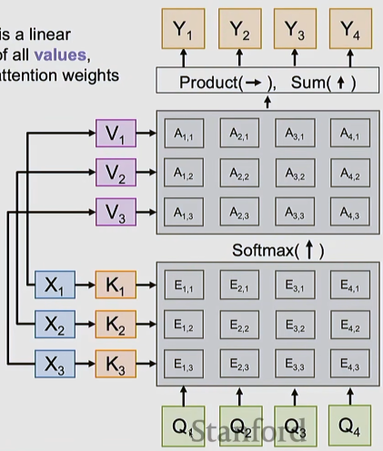

  - Self-Attention Layer

    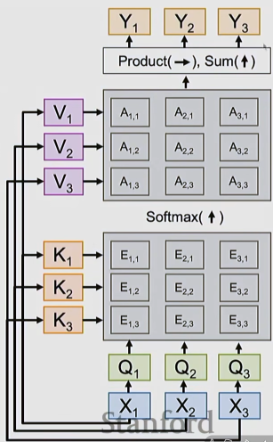

    - Problem: Self-Attention does not know the order of the sequence.
    - Solution: Add positional encoding to each input; this is a vector that is a fixed function of the index.
    - Self-Attention is Four Matrix Multiplies
      - QKV Projection
      - QK Similarity
      - V-Weighting
      - Output Projection

  - Masked Self-Attention Layer

    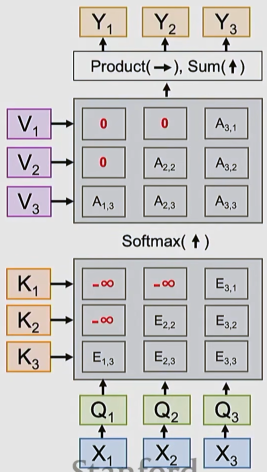

### Normalization Layers

### Architecture Design

### Video Understanding

- Video Classification
  - Single-Frame CNN (average)
  - Late Fusion (with FC layers)
    - Average Pool over space and time
  - Early Fusion: 2D CNN, no translation invariance of time
  - 3D CNN: have translation invariance of time
  - C3D: The VGG of 3D CNNs
  - Measuring Motion: Optical Flow => Separating Motion and Appearance: Two-Stream Networks
  - Inflating 2D Networks to 3D (I3D)
- Dataset: Sports-1M

### Vision and Language

- Multimodal foundation models

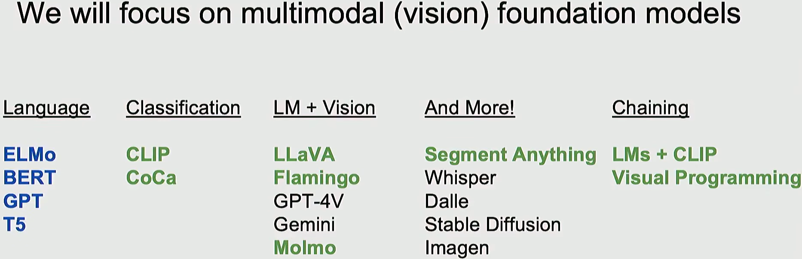

#### CLIP

Similar to SimCLR

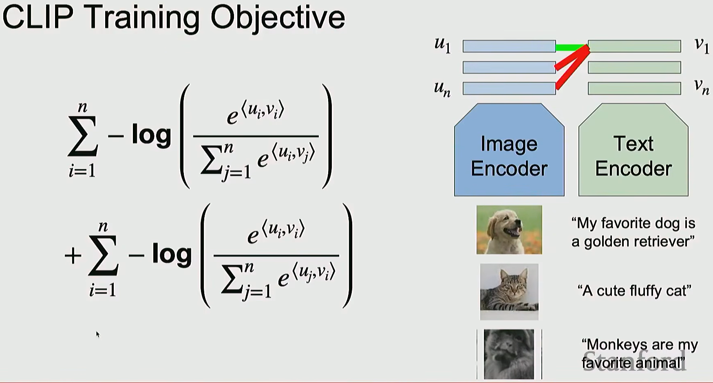

- How to get an "out of the box" classification (No fine-tuning)?
  - We can input labels into Test Encoder directly, or prompts (just like "A photo of a plane" and "A drawing of a plane", then take the mean vector).

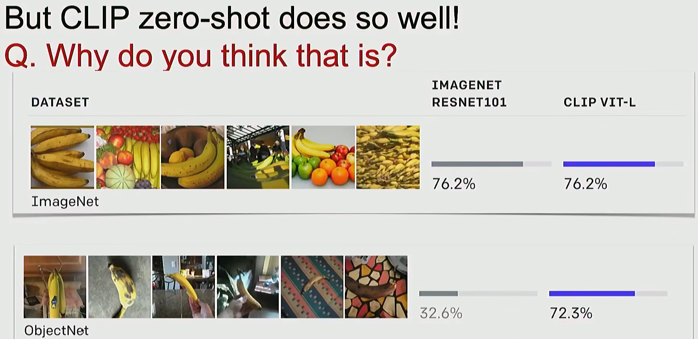

- Disadvantage
  - Rely too heavily on batch size to learn concepts

#### CoCa

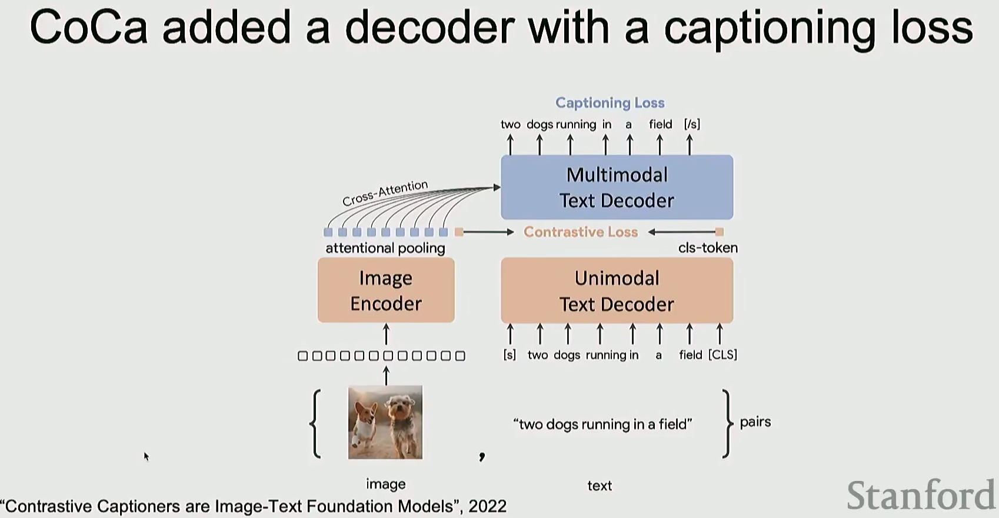

#### LLaVA

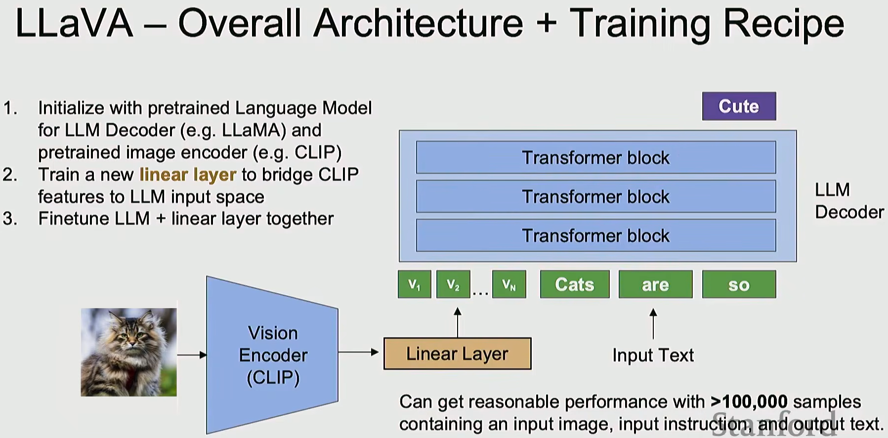

#### Flamingo

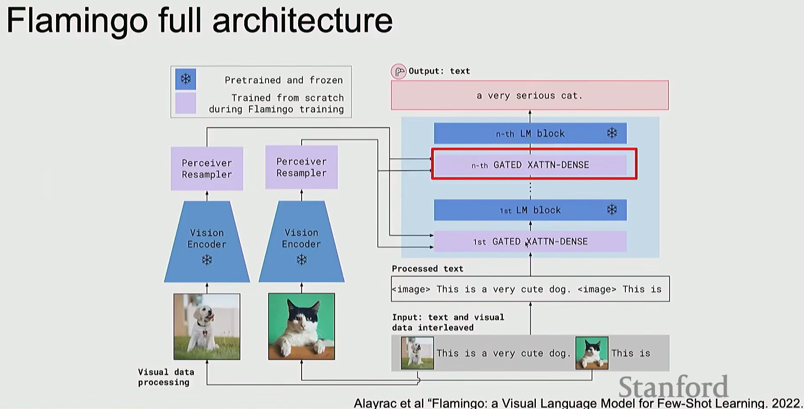

#### Molmo

- A high quality dataset is important, which means that a large dataset collected from the Internet is not always better than a small dataset where we add detailed description for an image.

#### SAM (Segment Anything Model)

#### Chaining

### 3D Vision

- Many ways to represent geometry
  - Explicit
    - Point cloud
    - Polygon mesh
    - Subdivision, NURBS
    - ...
  - Implicit
    - Lever sets
    - Algebraic surface
    - Distance functions
    - ...

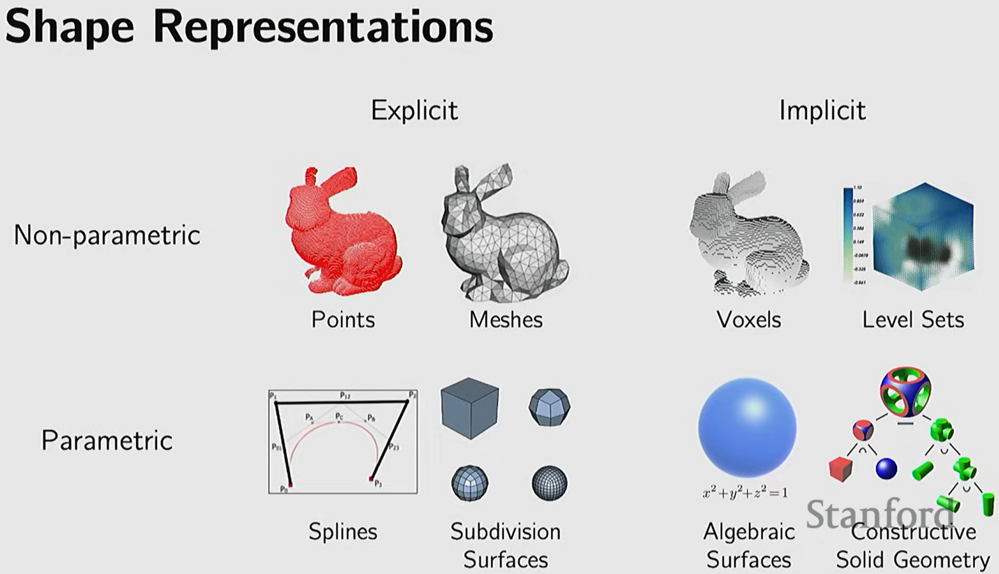

### Object Detection and Segmentation

#### Segmentation

- In-Network upsampling: "Unpooling"
  - Nearest Neighbor
  - Bed of Nails
- In-Network upsampling: "Max Unpooling"
- Learnable Unpsampling: Transposed Convolution
- U-Net

#### Object Detection

- R-CNN
- Masked R-CNN

#### Visualizing

- With pixels matter: Saliency via Backprop
  - Compute  gradient of (unnormalized) class score with respect to image pixels, take absolute value and max over RGB channels.

- CNN

  - Class Activation Mapping (CAM)

  - Gradient-Weighted Class Activation Mapping (Grad-CAM)

- Visualizing ViT features

## Reconstructing and Interacting with the Visual World

### Style Transfer

### Generative Models

1. Discriminative Model: Learn a probability distribution p(y|x)
2. Generative Model: Learn a probability distribution p(x)
3. Conditional Generative Model: Learn p(x|y)

"Generative models" means either of 2 and 3; conditional generative models are most common in practice while unconditional generative models are unuseful.

- Why Generative Models?
  - Modeling ambiguity: If there are many possible outputs x for an input y, we want to model P(x|y)

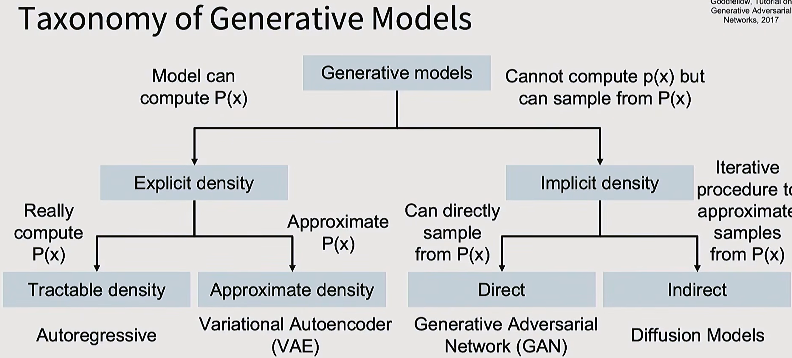

(Here, p(x) actually is p(x|y).)

#### Autogressive Models

#### VAE

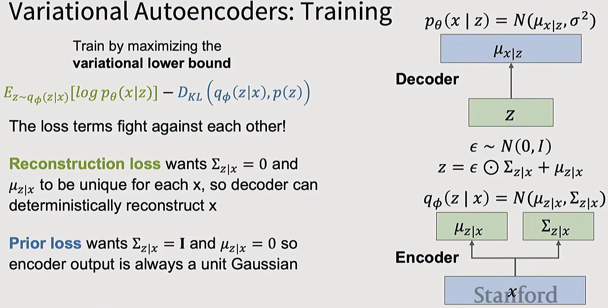

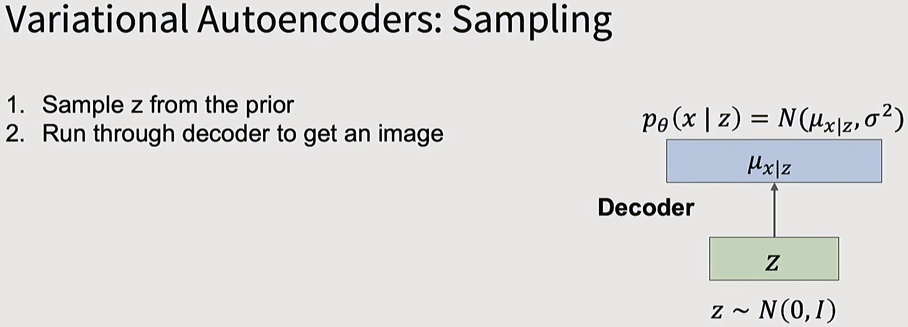

#### GAN

Popular from 2016 to 2021.

- GAN Architectures
  - DC-GAN
  - StyleGAN
- Latent Space Interpolation
- Pros:
  - Simple formulation
  - Very good image quality
- Cons:
  - No loss curve to look at
  - Unstable training
  - Hard to scale to big models + data

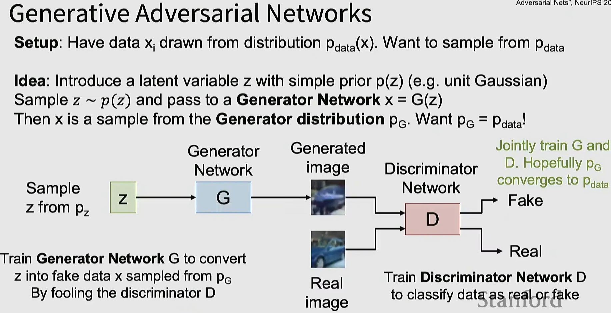

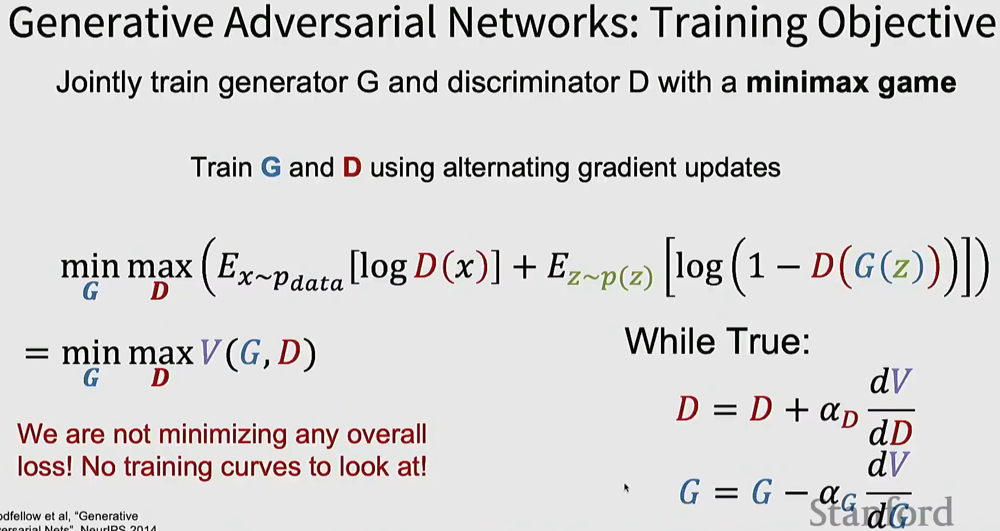

- **For discriminator network, its goal is to distinguish real data as "real" and generated data as "fake"; for the generator, its goal is to generate data that makes the discriminator classify it as "real".**

#### Diffusion Models

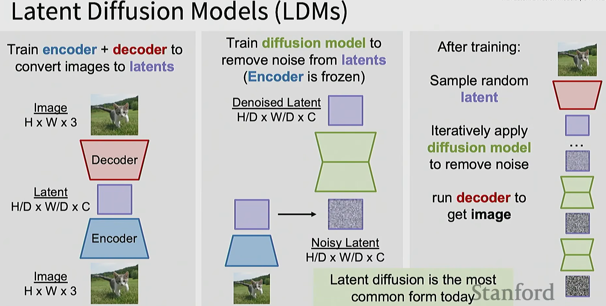

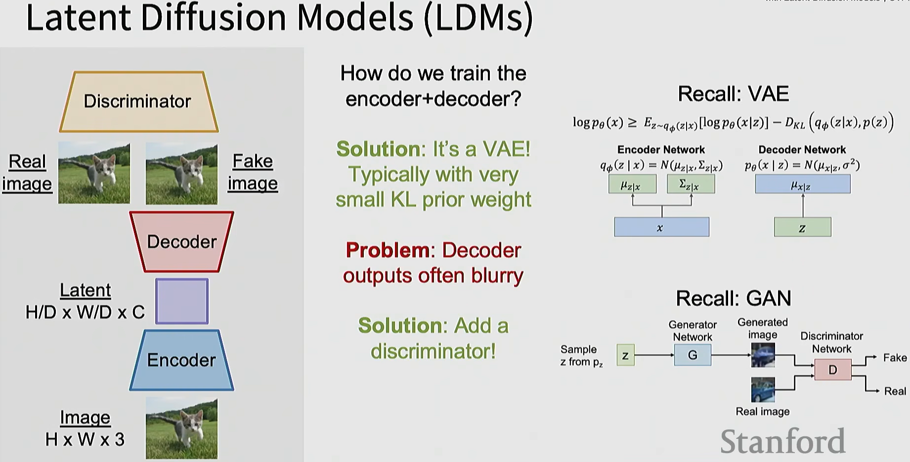

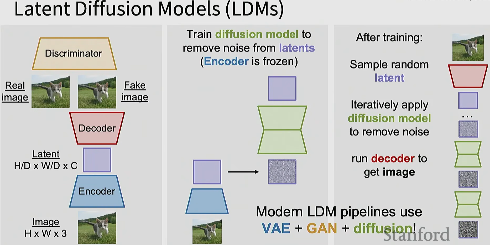

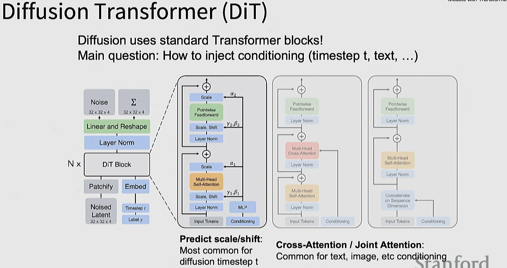

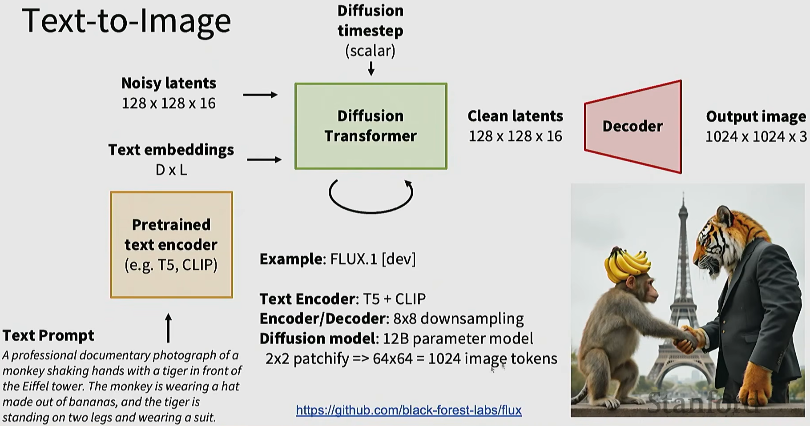

### Self-supervised Learning

- **Pretext tasks from image transformations**
  
  - image completion
  - **rotation** prediction
  - jigsaw puzzle (**Rearrangement**)
  - **colorization**
    - Split-brain Autoencoder
    - Video coloring: colorize the following frames based on the color of the current frame
  - predict missing pixels (**inpainting**)
    - **Masked Auto Encoders (*MAE*)**(Reconstruction-based learning): Uniformly sample a very large proportion (75%) of these patches and mask them.
  
- **Contrastive representation learning**: match 2 similar samples, which can be produced by human.
  
  - Intuition and formulation
  
  - Instance contrastive learning: ***SimCLR*** and ***MOCO***
  
    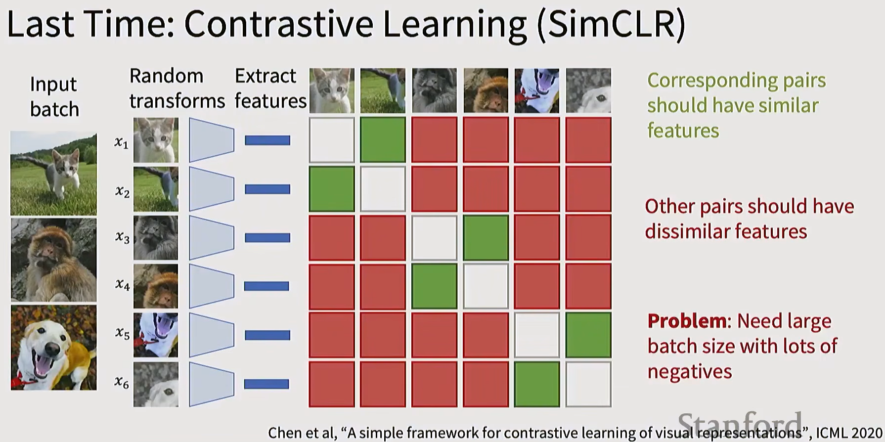

    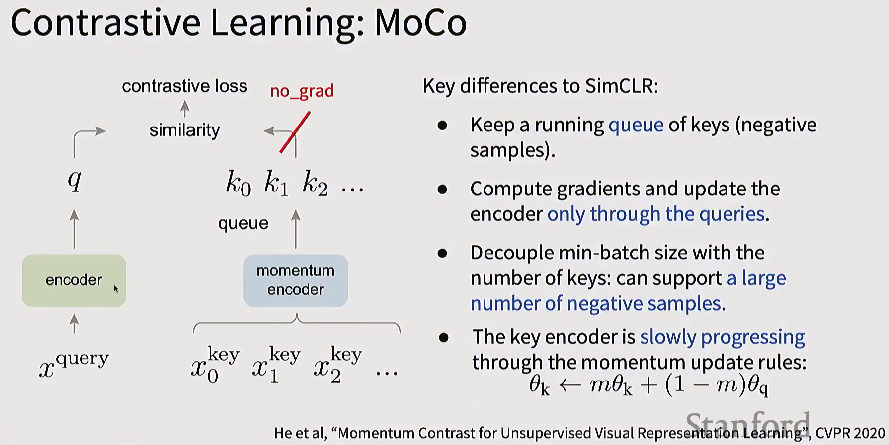

  - Sequence contrastive learning: ***CPC***
  
  - Self-Distillation Without Labels, ***DINO***
  
    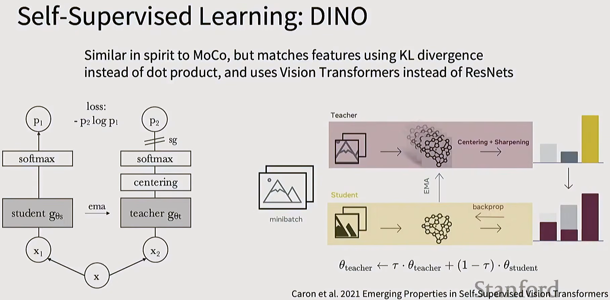
  
  - Loss: InfoNCE loss
  - SimCLR: A Simple Framework for Contrastive Learning
    - Problem: need large batch size, or else the task is too easy
  - Momentum Contrastive Learning (MoCo)
  
- How to evaluate a self-supervised learning method?
  1. lots of unlabeled data
  2. self-supervised learning
  3. feature extractor (e.g. a convnet)
  4. supervised learning (add small amount of labeled data on the target task): replace the last fc into linear classifier
  5. evaluate on the target task

### Image Generation

### Robotics and Embodied AI

- Problem Formulation

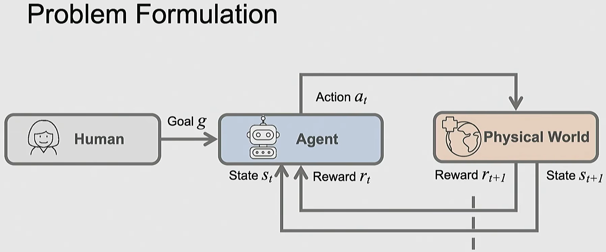

- In locomotion, the simulation doesn't have to be perfect. As long as you randomize it enough, it can generalize very robustly in the real environments. But in simulation, it's important.
- Models
  - Diffusion Policies

### OTHER

#### Large Scale Distributed Training

##### A bit about GPU hardware

- H100 GPU: 3352 GB/s inside the GPU
- **Server** = 8x GPU: 900 GB/s between GPUs
- **Rack** = 2 Servers = 16x GPU
- **Pod** = 192 Racks = 3072 GPUs: 50GB/s between GPUs
- **Cluster** = 8 Pods = 24576 GPUs: <50GB/s between GPUs

##### How to train on lots of GPUs

A model with L layers operates on tensors of shape (Batch, Sequence, Dim)

- **Data Parallelism (DP)**: Split on Batch dimension
  - Fully Sharded Data Parallelism (FSDP)
  - Hybrid Sharded Data Parallelism (HSDP)
  - Activation Checkpointing
- **Context Parallelism (CP)**: Split on Sequence dimension
- **Pipeline Parallelism (PP)**: Split on L dimension
- **Tensor Parallelism (TP)**: Split on Dim dimension

Scaling recipe:

1. Use data parallelism up to ~128 GPUs, models with ~1B params
2. Always set per-GPU batch size to max out GPU memory
3. If your model is >1B params, consider FSDP
4. Add activation checkpointing to fit larger batches per GPU
5. If you have >256 GPUs, consider HSDP
6. If you have >1K GPUs, models >50B params, or sequence lengths >16K then use more advanced strategies (CP, PP, TP)

- Problem: Lots of knobs to tune! How should we set them?

- Solution: Maximize Model Flops Utilization (MFU)
