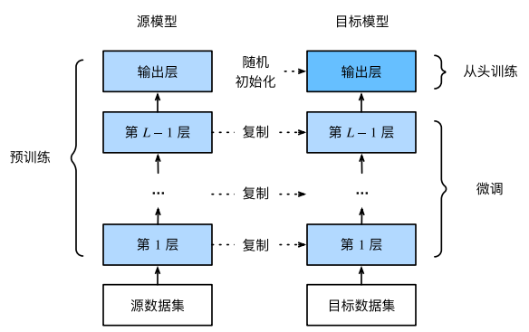
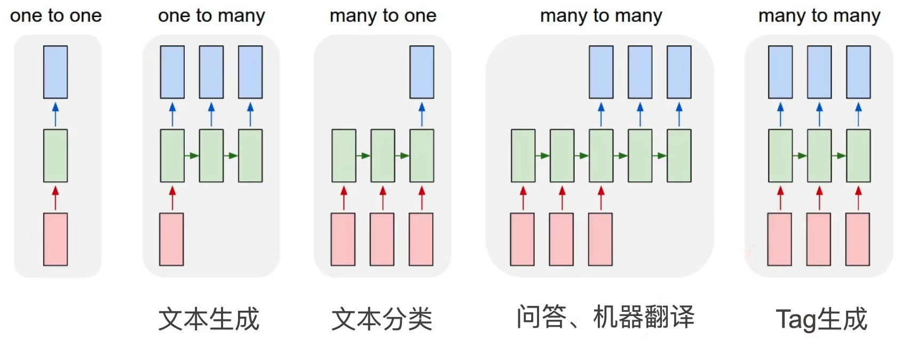
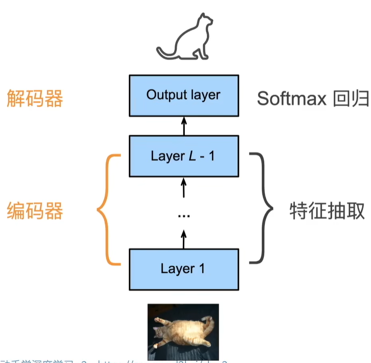
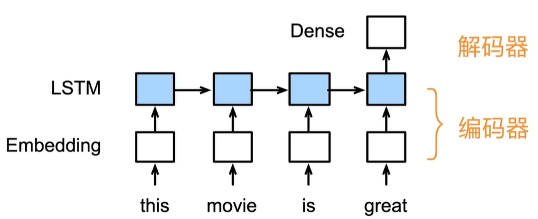
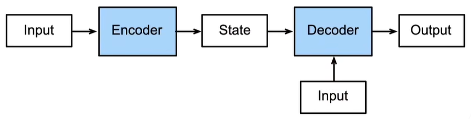

原则：记录深度学习的规律，例如模型构建、训练等方面的技巧；阐释我自己对于深度学习各知识点的理解，探究本质。

## 前置

- 深度学习一般用 32 位浮点数即可
- 反向累积过程中只需要按照确定的分支计算即可（类似反推法），其他分支的数值可以不用计算和存储
- 深度学习中一般是对标量求导

## 线性神经网络

### 线性回归

- 小批量随机梯度下降
  - 由于在整个训练集上计算梯度太贵，故取小批量样本来近似计算损失，从而求取近似梯度。
  - 更新公式：
  $$
  (\mathbf{w},b)\leftarrow(\mathbf{w},b)-\frac{\eta}{|\mathcal{B}|}\sum_{i\in\mathcal{B}}\partial_(\mathbf{w},b)l^{(i)}(\mathbf{w},b)
  $$
  - 对于公式的理解：事实上，前面应该加上 For every batch，$i$指的是一个小批量$\mathcal{B}$当中的第$i$个样本，因此$\frac{1}{|\mathcal{B}|}\sum_{i\in\mathcal{B}}\partial_{(\mathbf{w},b)}l^{(i)}(\mathbf{w},b)$是批量$\mathcal{B}$中的平均损失，故在数据并行计算时可以同时在不同的 GPU 上计算批量中的两小块数据的损失，再将损失相加，最后除以批量大小。一个批量算完之后再更新梯度，epoch 即是在训练集上多滚几遍，把数据拟合得更好。
- 对**权重**求导，故权重在初始化时需要`requires_grad=True`
- 定义
  - 数据迭代读取函数
  - 模型架构：net 的本质是如何进行正向计算，即给定输入、权重如何求出输出
  - 模型参数初始化
  - 损失函数
  - 优化器
- 训练的过程：
  - 对每一个 epoch
    - 取批量样本
      - 计算批量样本的损失
      - （参数梯度置零）
      - 对损失的和做反向传播（求导）
      - 更新参数（用优化器）
    - 输出训练信息（包括 epoch 和基于更新后的参数计算的 loss 的均值）

- 随机梯度下降本质是带来噪音，batch_size 越小正则化效果越明显
- data_iter 读取是把数据读进内存，如果数据太多内存会爆
- 用 batch_size 取数据未必需要保证取遍数据集，如果数据很多的话少取一些问题也不大

### Softmax 回归

- softmax 的本质：分类问题，把输出转换成概率，每一类的概率非负且总和为 1，相当于**单选题**
- 损失函数
  - L2 loss：离真实值越远梯度越大
  - L1 loss：梯度恒定，但零点处不可导（可能不稳定）
  - Huber's Robust loss：结合上述二者，即零点附近采用 L2，其余采用 L1
- softlabel 训练策略是将正确预测为 0.9，剩下预测为 0.1/n
- logistic 回归可以视作 softmax 回归的特例，即只需分 2 类的情况

## 多层感知机

### MLP

- 多类分类与 Softmax 回归的区别：加了隐藏层
- 等价于使用批量大小为 1 的梯度下降，损失函数为$l(y,x,w)=max(0,y<w,x>)$
- 激活函数作用在隐藏层，而且必须是非线性的，否则输出仍然是线性的
- 激活函数类别
  - Sigmoid 函数：(0,1)
  - Tanh 函数：(-1,1)
  - ReLU 函数：(0,$\inf$)，计算简单，较常用
- 模型构建技巧：例如输入维度为 128 的数据，分 5 类
  - 隐藏层大小逐层递减：128->64->32->16->8->5
  - 隐藏层大小先扩展再递减：128->256->128->64->32->16->8->5
  - 除 CNN 外，一般不会先减再增，因为那样会损失信息
- 两种方法：一般来说，深一点更好
  - 64->256->5：不好训练，因为各个参数需要协调一致，使得能够一次性拟合出函数
  - 64->128->64->32->16->8->5：好训练，可以逐层地、从具体到抽象地抽提数据特征
- 理论上，单隐藏层 MLP 可以拟合所有函数，但实际上难以训练，故 CNN、RNN 的本质是告诉模型如何抽提数据信息，帮助模型更好地训练。**故深度神经网络架构设计的本质是尽量根据神经网络的方法描述数据的特性，使得模型更好训练，即通过神经网络描述对于问题的理解（神经网络是一种语言）**。神经网络不是科学，是一种工程，其中 50%是一种艺术。

### 模型选择、欠拟合和过拟合

- 训练集用于训练模型参数；验证集用于选择模型超参数；测试集只能使用一次（不能根据测试集调超参数）
- 估计模型容量：
  - 难以在不同种类算法之间比较，如树模型和神经网络
  - 主要因素：参数的个数、参数值的选择范围
- 超参数设计方法：首先靠经验；网格是遍历，随机是随机取 100 个点看其中效果最好的参数；贝叶斯方法需要至少几万次训练才会有比较好的效果
- 类别不平衡时，需要首先保证**验证集**中类别平衡
- k 折交叉验证的 3 种使用方法：
  - 使用 k 折交叉验证确定的超参数再训练一遍全部数据
  - 以损失部分训练集为代价，取其中效果最好的一折作为最终模型
  - 使用 k 折中的每个模型做预测，最后做集成

### 权重衰退

- 为什么叫做权重衰退？
  损失定义为$l(w,b)+\frac{\lambda}{2}||w||^2$
  则参数更新为
  $$
  w_{t+1}=(1-\eta\lambda)w_t-\eta\frac{\partial l(w_t,b_t)}{\partial w_t}
  $$

### 丢弃法

- 正则项只在训练中使用：他们影响模型参数的更新，从而降低模型复杂度。
- 丢弃概率是超参数，常取 0.5、0.9 或 0.1
- 丢弃法是每次 batch 输入，每一个隐藏层都要随机丢弃一次
- 在全连接层中使用，而 BN 在 CNN 中使用

### 数值稳定性和模型初始化

- 使用 NVIDIA 的 GPU 时，一般采用 16 位浮点数
- 梯度爆炸（e.g. ReLU 激活函数）
  - 值超出值域
  - 对学习率敏感：若学习率太大，大参数值，更大的梯度；若学习率太小，训练无进展，故需要在训练过程中不断调整学习率
- 梯度消失（e.g. Sigmoid 激活函数）
  - 梯度值变成 0
  - 不管如何选择学习率，训练没有进展
  - 对于底部层尤为严重，仅仅顶部层训练较好，无法让神经网络更深
- 让训练更加稳定（目标：让梯度值在合理的范围内）
  - 将乘法变成加法，如 LSTM、ResNet
  - 归一化：梯度归一化、梯度裁剪
  - 合理的权重初始和激活函数（使输入权重和输出权重的均值和方差相等）
    - 权重初始：Xavier 使得$\gamma_t(n_{t-1}+n_t)/2=1$，即$\gamma_t=2/(n_{t-1}+n_t)$（$n_{t-1}$是输入维度，$n_t$是输出维度，$\gamma_t$是权重的方差）
      - 正态分布$N(0,\sqrt{2/(n_{t-1}+n_t)})$
      - 均匀分布$u(-\sqrt{6/(n_{t-1}+n_t)},\sqrt{6/(n_{t-1}+n_t)})$
    - 激活函数：尽可能类似于$\sigma(x)=x$
      - 根据泰勒展开，relu 和 tanh 可以不调整，Sigmoid 需调整为$4sigmoid(x)-2$
- 出现 nan 或者 inf 的解决方法
  - 学习率一直往下调，直到不出现
  - 把权重初始值的方差调小，再慢慢调大

## PyTorch 和 GPU

- 模型架构通过 class 实现，需要在其中定义两件事情：一是模型结构如何（有哪些层和参数），二是模型如何运算（如激活函数、dropout 等）。
- 自定义层也可以通过 class 实现，最后嵌入模型
- 在全连接层中，假设层为`nn.Linear(4, 8)`，那么 weight 的 shape 为 (4, 8)，bias 的 shape 为 (8)
- 保存模型：只需保存模型参数
- 模型参数需要保存在同一块 GPU 上
- 跑项目的时候显存如果不够用可以把模型调小；如果把 batch_size 调小可能会导致 cuda 占用率不高
- GPU 满负荷运行没有问题，但是需要注意降温，不要超过 80 或者 90℃

## 卷积神经网络

### 前置知识

- 损失随 epoch 的变化曲线抖动剧烈的原因：
  - 学习率太大
  - 每次接收到很不一样的样本，因此需要增大 batch_size
- 填充：通常取$p_h=k_h-1$、$p_w=k_w-1$使得输入输出形状不变
- 步幅：通常取步幅为 1，否则是因为考虑到计算量太大，则通常取 2 使之减半
- 3 个超参数中，核大小是最关键的（一般取 3*3，填充一般取默认，步幅则取决于需要将模型复杂度控制在什么程度
- 一般来说不会手写神经网络，除非输入的数据是非常特别的情况，基本上是套用经典的网络结构
- 机器学习就是一个压缩算法，即把像素、数据等信息压缩到人能理解的语义信息
- 多个输入通道：每个通道都有一个卷积核，结果是所有通道卷积结果的和
- 多个输出通道：我们可以有多个三维卷积核，每个核生成一个输出通道
- 多个输入和输出通道
  - 每个输出通道可以识别**特定模式**
  - 输入通道核识别并组合输入中的模式
- **1*1 卷积层**：不识别空间模式，只是融合通道；相当于输入形状为$n_hn_w\times c_i$，权重为$c_i\times c_o$的全连接层（即输入神经元个数为$c_i$，输出神经元个数为$c_o$）
- 二维卷积层
  - 输入 X：$c_i\times n_h\times n_w$
  - 核 W：$c_o\times c_i\times k_h\times k_w$
  - 偏差 B：$c_o\times c_i$
  - 输出 Y：$c_o\times m_h\times m_w$
  - 计算复杂度（浮点计算数 FLOP）：$O(c_ic_ok_hk_wm_hm_w)$
- 池化层：缓解卷积层对位置的敏感性，通常作用在卷积层之后
  - 最大池化层：每个窗口中最强的模式信号
  - 平均池化层
  - 特点：输入通道数=输出通道数，没有可以学习的参数，但是同样有填充、步幅、大小作为超参数

### 模型

- LeNet
  - 由两个部分组成：卷积编码器和全连接层密集块
  - 通道增加，高宽减小（信息实际上没有丢失太多）
  - 中间计算层的输出通道应该与数据复杂度相关，如果过大会过拟合
  - LeNet 的 batch_size 大于 1000 收敛变慢的原因：同一个批次中类似的图片太多，即重复的图片重复计算，从而影响收敛
  - 架构：

  ```txt
  Reshape output shape:    torch.Size([1, 1, 28, 28])
  Conv2d output shape:     torch.Size([1, 6, 28, 28])
  Sigmoid output shape:    torch.Size([1, 6, 28, 28])
  AvgPool2d output shape:  torch.Size([1, 6, 14, 14])
  Conv2d output shape:     torch.Size([1, 16, 10, 10])
  Sigmoid output shape:    torch.Size([1, 16, 10, 10])
  AvgPool2d output shape:  torch.Size([1, 16, 5, 5])
  Flatten output shape:    torch.Size([1, 400])
  Linear output shape:     torch.Size([1, 120])
  Sigmoid output shape:    torch.Size([1, 120])
  Linear output shape:     torch.Size([1, 84])
  Sigmoid output shape:    torch.Size([1, 84])
  Linear output shape:     torch.Size([1, 10])
  ```

- AlexNet
  - 主要改进：dropout、relu、maxpooling、数据增强（增强模型泛化性）
  - 一般来说，卷积层改变通道数但不改变高宽，池化层改变高宽但不改变通道数
  - 架构：

  ```txt
  Conv2d Output shape:    torch.Size([1, 96, 54, 54])
  ReLU Output shape:      torch.Size([1, 96, 54, 54])
  MaxPool2d Output shape: torch.Size([1, 96, 26, 26])
  Conv2d Output shape:    torch.Size([1, 256, 26, 26])
  ReLU Output shape:      torch.Size([1, 256, 26, 26])
  MaxPool2d Output shape: torch.Size([1, 256, 12, 12])
  Conv2d Output shape:    torch.Size([1, 384, 12, 12])
  ReLU Output shape:      torch.Size([1, 384, 12, 12])
  Conv2d Output shape:    torch.Size([1, 384, 12, 12])
  ReLU Output shape:      torch.Size([1, 384, 12, 12])
  Conv2d Output shape:    torch.Size([1, 256, 12, 12])
  ReLU Output shape:      torch.Size([1, 256, 12, 12])
  MaxPool2d Output shape: torch.Size([1, 256, 5, 5])
  Flatten Output shape:   torch.Size([1, 6400])
  Linear Output shape:    torch.Size([1, 4096])
  ReLU Output shape:      torch.Size([1, 4096])
  Dropout Output shape:   torch.Size([1, 4096])
  Linear Output shape:    torch.Size([1, 4096])
  ReLU Output shape:      torch.Size([1, 4096])
  Dropout Output shape:   torch.Size([1, 4096])
  Linear Output shape:    torch.Size([1, 10])
  ```

- VGG
  - 使用块的网络：深但窄效果更好
    - VGG 使用可重复使用的卷积块来构建深度卷积神经网络
    - 不同的卷积块个数和超参数可以得到不同复杂度的变种
  - 结构：
    - 3*3 卷积（填充 1）（n 层，m 通道）
    - 2*2 最大池化层（步幅 2）
  - 启示：做研究、做实践的时候，尽量用简单的模型，不要过度地设计，这样可以让我的研究在以后被重复使用（更容易被记住）
- NiN
  - 网络中的网络
    - NiN 块使用卷积层加两个 1*1 卷积层，后者对每个像素增加了非线性性
    - NiN 使用全局平均池化层来替代 VGG 和 AlexNet 中的全连接层：不容易过拟合，更少的参数个数
  - NiN 块：一个卷积层后跟两个全连接层=>步幅 1，无填充，输出形状跟卷积层输出一样，起到全连接层的作用
  - 架构：
    - 无全连接层
    - 交替使用 NiN 块和步幅为 2 的最大池化层（逐步减小高宽和增大通道数）
    - 最后使用全局平均池化层得到输出（其输入通道数是类别数）
  - 全局池化层：提升模型泛化性，但降低收敛速度
- GoogLeNet
  - 5 段，9 个 Inception 块
  - Inception 块：4 个路径（1\*1、3\*3、5\*5、MaxPool）从不同层面抽取信息，然后在输出通道维合并
    - 跟单 3\*3 或 5\*5 卷积层比，Inception 块有更少的参数个数和计算复杂度
    - 4 条路径通道数分配方法论：3\*3 大小合适，分配大约一半，1\*1 分配 1/4，剩下两条路径再做平分；其中，3\*3 和 5\*5 中的两层按照 1/2 或 3/4 通道再做分配
    - 3\*3 和 5\*5 中的 1\*1 用来降低通道数，从而降低计算复杂度
  - 后续变种
    - Inception-BN(V2)：使用 batch_normalization
    - Inception-V3：修改了 Inception 块
      - 替换 5\*5 为多个 3\*3 卷积层
      - 替换 5\*5 为 1\*7 和 7\*1 卷积层
      - 替换 3\*3 为 1\*3 和 3\*1 卷积层（降低计算量）
      - 更深
    - Inception-V4：使用残差连接
  - 主要优点：模型参数小，计算复杂度低
  - 除非是专家，否则最好不要改经典架构，最多可以：所有通道数除以 4；调整输入输出的长宽
- ResNet
  - 加更多层不会让模型效果变差，通常来说是变好的
  - 残差块使得很深的网络更加容易训练，甚至可以训练一千层的网络
  - 1\*1 卷积层用于改变通道数，使得两条路径的输出通道数能够一致
  - 可以解决梯度消失问题
  - 架构
    - 类似 VGG 和 GoogLeNet 的总体架构，但替换成了 ResNet 块
    - 总共 5 个 stage，第一个 stage 一般就是 7\*7 Conv、Batch Norm 和 3\*3 Max Pooling

### 批量归一化

- 背景：损失出现在最后，后面的层训练较快，底部的层训练较慢，故底部层一变化，所有都得跟着变，最后的那些层需要重新学习多次，导致收敛变慢，因此需要在学习底部层的时候避免变化顶部层
- 解决方法：固定小批量里面的均值和方差，然后学习出适合的偏移和缩放
  - 可学习的参数为$\gamma$和$\beta$
  - 作用在
    - 全连接层和卷积层输出上，激活函数前
    - 全连接层和卷积层输入上
  - 对全连接层，作用在特征维
  - 对于卷积层，作用在通道维
- 可能是通过在每个小批量里加入噪音来控制模型复杂度，因此没必要跟丢弃法混合使用
- 可以加速收敛速度（允许用更大的学习率），但一般不改变模型精度
- Batch Normalization 在深度的神经网络中有用些
- 首先调 batch size（与内存相匹配），然后调学习率，最后调 epoch
- 调 batch size：如果增大但是每秒处理样本数没有变化就可以停了，GPU-utl 大约 90%即可

## 深度学习硬件

### CPU 和 GPU

- 提升 CPU 利用率
  - **本地性**：在计算$a+b$之前，需要准备数据
    - 主内存->L3->L2->L1->寄存器
      - L1（Shared LLC）访问延迟：0.5ns
      - L2（Core）访问延迟：7ns(14L1)
      - 主内存访问延迟：100ns(200L1)
    - 提升空间和时间的内存本地性
      - 时间：重用数据使得保持它们在缓存里
      - 空间：按序读写数据使得可以预读取
  - **并行计算**：高端 CPU 有几十个核，并行来利用所有核
    - 超线程不一定提升性能，因为它们共享寄存器
- 每秒钟计算的浮点数=核的数目、*主频
- GPU VS. CPU
  - GPU 比 CPU 快的原因：核多、内存带宽大
  - GPU 相比 CPU 的弱点：内存小、控制流弱
- 提升 GPU 利用率
  - 并行：使用数千个线程
  - 内存本地性：缓存更小，架构更加简单
  - 少用控制语句：支持有限，同步开销很大
  - 不要频繁在 CPU 和 GPU 之间传数据：带宽限制，同步开销
- CPU/GPU 高性能计算编程
  - CPU：可以处理通用计算。性能优化考虑数据读写效率和多线程
    - C++或者任何高性能语言：编译器成熟
  - GPU：使用更多的小核和更好的内存带宽，适合能大规模并行的计算任务
    - Nvidia 上用 CUDA：编译器和驱动成熟
    - 其他用 OpenCL：质量取决于硬件厂商
  - 投入多少人力物力做硬件，就要投入多少人力物力做编译器
- QA
  - 不要过度调参，调参只是针对当前数据做到最优，差不多即可
  - 分布式需要考虑容错，高性能不太考虑容错，高性能是分布式的一种应用
  - 性能类似于计算量除以内存访问速度，这个比率越高越好

### TPU 和其他

- DSP：数字信号处理
  - 为数字信号处理算法设计：点积、卷积、FFT
  - 低功耗、高性能：比移动 GPU 快 5 倍，功耗更低
  - VLIW(Very long instruction word)：一条指令计算上百次乘累加
  - 编程和调试困难
  - 编译器质量良莠不齐
- 可编程阵列 (FPGA)
  - 有大量可以编程逻辑单元和可配置的连接
  - 可以配置成计算复杂函数：编程语言（VHDL、Verilog）
  - 通常比通用硬件更高效
  - 工具链质量良莠不齐
  - 一次“编译”需要数小时
- AI ASIC：以 Google TPU 为代表
  - 能够媲美 Nvidia GPU 性能
  - 在 Google 大量部署，框架最好用 tensorflow
  - 核心是 Systolic Array
    - 计算单元（PE）阵列；特别适合做矩阵乘法；设计和制造相对简单
    - 对于一般的矩阵乘法，通过切开和填充来匹配 SA 大小
    - 批量输入来降低延时
    - 通常有其他硬件单元来处理别的 NN 操作子，例如激活层
  - 只适合特定任务，通用性差
- QA
  - softmax vs sigmoid：softmax 用来做输出，sigmoid 用来做激活
  - GPU 实际上定义了当前的神经网络架构（硬件定义了一代算法），神经网络之所以不像大脑，是因为硬件（冯诺依曼架构）不像大脑，例如 Transformer 就特别适合在 TPU（内存大）上跑

## 计算性能

### 单机多卡并行

- 一台机器可以安装多个 GPU（1-16）
- 在训练和预测时，我们将一个小批量计算切分到多个 GPU 上来达到加速目的
- 常用切分方案：
  - 数据并行：将小批量分成 n 块，每个 GPU 拿到完整参数计算一块数据的梯度，通常性能更好
    1. 读一个数据块 (batch)
    2. 拿回参数
    3. 计算梯度（除以批量大小而非实际切分数据块的大小）
    4. 发出梯度
    5. 更新梯度
  - 模型并行：将模型分成 n 块，每个 GPU 拿到一块模型计算它的前向和反向结果，通常用于模型大到单 GPU 放不下
  - 通道并行（数据+模型并行）
- 多 GPU 训练但不变快的原因
  - data 读取比较慢
  - GPU 增加但 batch_size 没增加，因此 GPU 翻倍时一般 batch_size 也翻倍，同时 lr 也翻倍（但 lr 增大会导致训练振荡）

### 分布式训练

- 机器之间通过网络通讯，底部 GPU 之间通讯快，因此尽量在底部做数据传输，不要在 GPU 和 CPU 之间或不同机器之间做数据传输
- 同步 SGD
  - 这里每个 worker 都是同步计算一个批量，称为同步 SGD
  - 假设有 n 个 GPU，每个 GPU 每次处理 b 个样本，那么同步 SGD 等价于在单 GPU 运行批量大小为 nb 的 SGD
  - 在理想情况下，n 个 GPU 可以得到相对单个 GPU 的 n 倍加速
- 性能
  - 记$t_1$为在单 GPU 上计算 b 个样本梯度时间
  - 假设有 m 个参数，一个 worker 每次发送和接收 m 个参数、梯度，记$t_2$为发送和接收所用时间
  - 每个批量的计算时间为$max(t_1,t_2)$
    - 选取足够大的 b 使得$t_1>t_2$
    - 增加 b 或 n 导致更大的批量大小，导致需要更多计算来得到给定的模型精度
- 实践时的建议
  - 使用一个大数据集
  - 需要好的 GPU-GPU 和机器-机器带宽
  - 高效的数据读取和预处理
  - 模型需要有好的计算（FLOP）通讯（model size）比：Inception > ResNet > AlexNet
  - 使用足够大的批量大小来得到好的系统性能
  - 使用高效的优化算法对应大批量大小
- QA
  - batch_size 越大，因为参数更新时对损失取了平均，因此需要处理更多的样本才能达到 batch_size 较小时所达到的训练精度，因此训练的有效性降低
  - 一个训练数据有 n 类的话，那么批量大小最好不要超过$10n$或者$20n$

## 计算机视觉

### 数据增广

- 翻转
  - 左右翻转、上下翻转（不一定总是可行，需要根据数据的实际背景）
- 切割：从图片中切割一块，然后变形到固定形状
  - 随机高宽比、随机大小、随机位置
- 颜色
  - 改变色调、饱和度、亮度
- Trick
  - 图片增强方法集合：imgaug 网站
  - 从后往前推
- QA
  - 对于图神经网络，除非是专家，否则一般不要应用图神经网络，应用程度不够
  - mix-up：样本叠加，标签通过 one-hot 编码叠加

### 微调

- 一个神经网络一般可以分成两块
  - 特征抽取将原始像素变成容易线性分割的特征
  - 线性分类器来做分类

- 训练
  - 是一个目标数据集上的正常训练任务，但使用更强的正则化
    - 使用更小的学习率
    - 使用更少的数据迭代
  - 源数据集远复杂于目标数据（10 倍或 100 倍），通常微调效果更好
- 重用分类器权重
  - 源数据集可能也有目标数据中的部分标号
  - 可以使用预训练好模型分类器中对应标号对应的向量来做初始化
- 固定一些层
  - 神经网络通常学习有层次的特征表示
    - 低层次的特征更加通用
    - 高层次的特征则更跟数据集相关
  - 可以固定底部一些层的参数，不参与更新：更强的正则
- 总结
  - 微调通过使用在大数据上得到的预训练好的模型来初始化模型权重来提升精度
  - 预训练模型质量很重要
  - 微调通常速度更快、精度更高
- QA
  - 做计算机视觉尽量从微调开始，而不要自己从零开始
  - 如果做的是癌症图像识别，那么应该找医学上的 pretrain 的 model，而非 ImageNet 的
  - 微调是迁移学习中的一种算法
  - 微调源数据集中未必需要包含目标数据集的类别，但是需要尽可能相似
  - 微调对学习率不敏感，最好选一个比较小的学习率

### 物体检测

- 一个边缘框可以通过 4 个数字定义
  - 左上 x，左上 y，右下 x，右下 y
  - 左上 x，左上 y，宽，高
- 目标检测数据集
  - 每行表示一个物体：图片文件名，物体类别，边缘框
  - COCO(cocodataset.org)：80 物体、330K 图片、1.5M 物体

### 锚框

- 一类目标检测算法是基于锚框
  - 提出多个被称为锚框的区域（边缘框）
  - 预测每个锚框里是否含有关注的物体
  - 如果是，预测从这个锚框到真实边缘框的偏移
- 交并比（IoU）
  - IoU 用来计算两个框之间的相似度：0 表示无重叠，1 表示重合
  - 这是 Jacquard 指数的一个特殊情况
  $$
  J(A,B)=\frac{|A\cap B|}{|A\cup B|}
  $$
- 赋予锚框标号
  - 每个锚框是一个训练样本
  - 将每个锚框，要么标注成背景，要么关联上一个真实边缘框
  - 我们可能会生成大量的锚框：导致大量的负类样本
- 使用非极大值抑制（NMS）输出
  - 每个锚框预测一个边缘框
  - NMS 可以合并相似的预测
    - 选中是非背景类的最大预测值
    - 去掉所有其他和它 IoU 值大于$\theta$的预测
    - 重复上述过程直到所有预测要么被选中，要么被去掉
- 假设输入图像的高度为$h$，宽度为$w$。我们以图像的每个像素为中心生成不同形状的锚框：缩放比为$s$，宽高比为$r$，则
  $$
  s^2=\frac{w'h'}{wh}
  $$
  同时因为在很多实现中，图像会被 resize 成正方形；或者以 h 作为尺度基准；或者默认 h≈w，故面积$A=h^2s^2$，就有$h^2s^2=w'h'=rh'^2$，故
  $$
  h'=hs/\sqrt{r}\\
  w'=hs\sqrt{r}
  $$
  这是尺度由$s$控制，形状由$r$控制的设计
- 在实践中，对于每个像素的锚框，我们只考虑包含$s_1$或$r_1$的组合，即以同一像素为中心的锚框的数量是$n+m-1$，对于整个输入图像，将共生成$wh(n+m-1)$个锚框
- 非极大值抑制 (NMS)：对于相似的锚框做去重处理

### 目标检测算法

#### R-CNN 系列

- R-CNN（区域卷积神经网络）
  - 使用启发式搜索算法来选择锚框
  - 使用预训练模型来对每个锚框抽取特征
  - 训练一个 SVM 来对类别分类
  - 训练一个线性回归模型来预测边缘框偏移
- 兴趣区域 (RoI) 池化层
  - 给定一个锚框，均匀分割成$n\times m$块，输出每块里的最大值
  - 不管锚框多大，总是输出$nm$个值
  - 目的：使每个锚框变成相同的形状，以用于做 batch
- Fast RCNN
  - 使用 CNN 对**整张图片**抽取特征，同时做锚框的映射
  - 使用 RoI 池化层对每个锚框生成固定长度特征
- Faster R-CNN：使用一个区域提议网络（RPN, Region Proposal Network）来替代启发式搜索来获得更好的锚框
- Mask R-CNN：如果有像素级别的标号，使用 FCN 来利用这些信息

#### SSD

- SSD（单发多框检测）
  - 一个基础网络来抽取特征，然后多个卷积层块来减半高宽
  - 在每段都生成锚框：底部段来拟合小物体，顶部段来拟合大物体
  - 对每个锚框预测类别和边缘框

#### YOLO

- SSD 中锚框大量重叠，因此浪费了很多计算
- YOLO 将图片均匀分成$S\times S$个锚框
- 每个锚框预测$B$个边缘框
- 后续版本有持续改进
- QA
  - 多模型融合不适合发论文

### 语义分割

- 语义分割将图片中的每个像素分类到对应的类别
- 应用：背景虚化
- VS 实例分割：细分出 dog1, dog2 等
- 最重要的语义分割数据集之一是 Pascal VOC2012

### 转置卷积

- 卷积不会增大输入的高宽，通常要么不变、要么减半
- 转置卷积则可以用来增大输入高宽
- 不是用来还原图片（预测每个像素的 RGB 值），而是用来对每个像素预测标号，用于语义分割

### 全连接卷积神经网络（FCN）

- FCN 是用深度神经网络来做语义分割的奠基性工作，但现在用得不多
- 它用转置卷积层来替换 CNN 最后的全连接层，从而可以实现每个像素的预测
- 对每个像素类别的预测存在通道里面
- CNN 的好处是输入图片的大小可以改变，不像 MLP
- 采用双线性插值方法初始化转置卷积可以使之真的放大图片
- 1\*1 卷积层的作用是降低转置卷积的计算量

### 样式迁移

- 采用固定模型对内容图片、样式图片和生成图片抽特征，然后分别对内容层、样式层和图片噪点计算损失，以此做反向传播。在这个过程中，变化的是生成图片，其他保持不变。

## 循环神经网络

### 序列模型

- 序列模型：
  $$
  p(x)=p(x_1)p(x_2|x_1)p(x_3|x_1,x_2)\cdots p(x_T|x_1,x_2,...,x_{T-1})
  $$
- 对条件概率建模：
  $$
  p(x_t|x_1,x_2,...,x_{t-1})=p(x_t|f(x_1,x_2,...,x_{t-1}))
  $$
  其中，$f(x_1,x_2,...,x_{t-1})$是对见过的数据建模，因此也称自回归模型（预测自身而非预测标签）
- 方案 A：马尔可夫假设：当前数据只跟$\tau$个过去数据点相关，由于数据特征定长，故用一个 MLP 即可实现 f 的建模
- 方案 B：潜变量模型：引入潜变量$h_t$来表示过去信息$h_t=f(x_1,x_2,...,x_{t-1})$，这样$x_t=p(x_t|h_t)$
- 序列模型中，记住序列未必是一件好事，因为这往往意味着泛化性较差

### 文本预处理

- 对 unique token 按 frequency 排序有助于提升计算性能
- 训练集和测试集必须采用同一个 vocab

### 语言模型

- 使用计数来建模
  - 例如，当序列长度为 2 时，有
    $$
    p(x,x')=p(x)p(x'|x)=\frac{n(x)}{n}\frac{n(x,x')}{n(x)}
    $$
  - N 元语法：使用马尔可夫假设缓解这个问题，即$\tau=N$，常用二元语法或三元语法
- 读取长序列数据
  - 随机采样
  - 顺序分区：确保两个相邻小批量中的子序列在原始序列上也是相邻的
- num_steps 一般设成 32 最佳，16、256、512 也可以，取决于一句话有多长。长度通常取决于模型复杂度、任务需求、线上实现的参数。

### RNN

- 公式
  - 更新隐藏状态：$h_t=\phi(W_{hh}h_{t-1}+W_{hx}x_{t-1}+b_h)$
  - 输出：$o_t=W_{ho}h_t+b_o$
- 困惑度 (perplexity)
  - 衡量一个语言模型的好坏可以用平均交叉熵
    $$
    \pi=\frac{1}{n}\sum_{i=1}^n-logp(x_t|x_{t-1},...)
    $$
    其中$p$是语言模型的预测概率，$x_t$是真实词
  - 历史原因 NLP 使用困惑度$e^{\pi}$来衡量：1 表示完美，无穷大是最差情况
- 梯度裁剪：将梯度投影回$\theta$长度，防止梯度爆炸
- 更多的应用 RNNs
  
- 循环神经网络的输出取决于当下输入和前一时间的隐变量
- Tip: 决定训练函数的是任务需求，而非模型类别
- 每一个时间步都可以看作是一个单隐藏层的 MLP
- 框架实现能够把小矩阵乘法整合成大矩阵乘法，因此能够提高计算效率
- 使用随机 iter 的原因：1、随机性更好，缓解过拟合；2、RNN 做不了很长的序列

### GRU

- 对于一个序列，不是每个观察值都是同等重要；有点像简化版的注意力机制
- 想只记住相关的观察需要：
  - 能关注的机制（更新门），即需要多少$X_t$的信息（反比），尽量不去看$X_t$
  - 能遗忘的机制（重置门），即需要多少$H_{t-1}$的信息（正比），尽量去看$X_t$
- $R_t$和$Z_t$本质上都是隐变量，$R_t$用于选择性地遗忘前一时间步的隐变量
- QA
  - 在实际应用过程中，尽量用 GRU 或者 LSTM（长度最好不要超过 100，否则用注意力机制），不要用 RNN（对长文本效果不好）

### LSTM

- 忘记门：将值朝 0 减少
- 输入门：决定是不是忽略掉输入数据
- 输出门：决定是不是使用隐状态，如果变成 0 即表示当前的$X_t$和过去的所有信息都不要，即重置
- 候选记忆单元：类似于 GRU 中的 H_tilda
- 记忆单元：记住多少前面的数据，与 GRU 的区别在于两个变量独立而非相加等于 1
- 隐状态：其中的 tanh 用于把值放到正负 1 之间
- 本质上来说，GRU 和 LSTM 都是想办法在过去信息和当前信息中取平衡
- H 是正负 1 之间的数字，C 可以用来存储信息（没有数值限制）

### 深度循环神经网络

- 使用更多隐藏层来获得更多的非线性性
- 实际应用中通常用 2 层即可
- 每层都需要一个初始 hidden state

### 双向循环神经网络

- 一个前向 RNN 隐层
- 一个反向 RNN 隐层
- 合并两个隐状态得到输出
- 代码实现：前向就是正常计算，反向就是把输入反一下，得到的输出再反一下，最后 cat 起来
- 非常不适合做推理，不能用于预测下一个词，因此主要的作用是对一个句子做特征提取（例如翻译、文本分类等场景）

### 编码器-解码器架构

- 所谓编码的意思就是把原始数据转换成计算机能够理解的数码，解码反之
- CNN
  - 下面层的 CNN 用于特征抽取，可以视作编码器；最后一层 Softmax 回归可以视作解码器
  - 编码器：将输入编程成中间表达形式（特征）
  - 解码器：将中间表示解码成输出

- RNN
  - 编码器：将文本表示成向量
  - 解码器：向量表示成输出

- 一个模型被分为两块：
  - 编码器处理输出
  - 解码器生成输出（也可以拿到输入）


### seq2seq

- 专门用来做机器翻译；由于可以做任意长度序列的处理，从一个句子生成另一个句子，所以叫做序列到序列的学习
- 编码器是一个 RNN，读取输入句子（双向经常用在 encoder 中），是没有输出的 RNN
- 解码器使用另外一个 RNN 来输出
- 编码器**最后一层最后一个时刻**的隐藏状态（包含了编码器输入的信息）作为解码器的初始状态
- 训练时解码器直接使用目标句子作为输入；推理时解码器使用上一个输出作为当期输入
- 衡量生成序列的好坏 BLEU
  - $p_n$是预测中所有 n-gram 的精度。例如：标签序列 A B C D E F 和预测序列 A B B C D，有$p_1=\frac45, p_2=\frac34, p_3=\frac13, p_4=0$
  - BLEU 定义：前面用于惩罚过短的预测，后面用于为长匹配分配高权重
    $$
    \exp{(\min{(0,1-\frac{len_{label}}{len_{pred}})})}\prod^k_{n=1}p_n^{1/2^n}
    $$
- decoder 中把最后一个状态和输入拼在一起的作用：使每个 token 既有自身的特征表示，又有来自 encoder 的信息表示。

### 束搜索

- 贪心搜索：在 seq2seq 中我们使用了贪心搜索（效率高）来预测序列，但贪心很可能不是最优的，即当前时间步的最优从整个句子来看未必是最优的
- 穷举搜索：太多，算不动
- 束搜索：
  - 保存最好的 k 个候选，在每个时刻，对每个候选新加一项（也就是往后再预测一个，每个有$n$种可能），在$kn$个选项中选出最好的$k$个
  - 时间复杂度$O(knT)$
  - 每个候选的最终分数：防止总是选最短的
    $$
    \frac{1}{L^{\alpha}}\log{p(y_1,...,y_L)}=\frac{1}{L^{\alpha}}\sum_{t'=1}^L\log{p(y_{t'}|y_1,...,y_{t'-1})}
    $$
  - $k=1$时是贪心搜索，一般来说 k 取 5 或者 10

## 注意力机制

### 注意力汇聚

- 心理学框架：人类根据随意线索和不随意线索选择注意点
  - 不随意线索是由于事物的客观的显著特征而产生的线索
  - 随意线索是人主观产生的线索
- 注意力机制
  - 卷积、全连接、池化层都只考虑不随意线索
  - 注意力机制则显示地考虑随意线索
    - 随意线索被称之为查询 (query)
    - 每个输入是一个值 (value) 和不随意线索 (key) 的对
    - 通过注意力池化层来有偏向性地选择某些输入
- 非参注意力池化层
  - 给定数据$(x_i,y_i),i=1,...,n$
  - 平均池化是最简单的方案：$f(x)=\frac{1}{n}\sum_iy_i$
  - 更好的方案是 60 年代提出来的 Nadaraya-Watson 核回归，其中$x$是 query，$x_j$是 key，$y_i$是 value，$f(x)$是查询结果，K 可以看作是衡量$x$与$x_i$距离的函数，可以理解成对于一个新数据 x 把与之相近的数据的 value 找出来看
    $$
    f(x)=\sum_{i=1}^n\frac{K(x-x_i)}{\sum_{j=1}^nK(x-x_j)}y_i
    $$
    - 若使用高斯核$K(u)=\frac{1}{\sqrt{2\pi}}\exp{(-\frac{u^2}{2})}$，则$f(x)=\sum_{i=1}^n\softmax{(-\frac12(x-x_i)^2)}y_i$
  - 拟合的函数过于平滑，实际中用得不多
- 参数化的注意力机制
  - 在之前基础上可以引入可以学习的$w$（w 控制的是高斯核窗口的大小，变窄），有
    $$
    f(x)=\sum_{i=1}^n\softmax{(-\frac12((x-x_i)w)^2)}y_i
    $$
  - 可以一般地写作$f(x)=\sum_i\alpha(x,x_i)y_i$，这里$\alpha(x,x_i)$是注意力权重

### 注意力分数

- 前面提到$\alpha(x,x_i)$是注意力权重，其中的 softmax 计算前的变量（$-\frac{1}{2}(x-x_i)^2$）是注意力分数
- 注意力分数的设计
  - Additive Attention：等价于**将 query 和 key 合并起来后放入到一个隐藏大小为 h 输出大小为 1 的单隐藏层 MLP**，query 和 key 不同长度也适用
    $$
    a(k,q)=v^T\tanh{W_kk+W_qq}
    $$
  - Scaled Dot-Product Attention：**直接将 query 和 key 做内积**，若 query 和 key 都是同样的长度 d，则
    $$
    a(q,k_i)=<q,k_i>/\sqrt{d}
    $$
    - 向量化版本：Q 为 (n, d)，K 为 (m, d)，V 为 (m, v)
    - 像注意力汇聚中提到的样例是标量，所以 d 为 1，训练时，n 为 1（每次查询一个），m 为 n_train-1，v 为 1，n_train 可以视作 batch_size
- num_key_value_pair 就是 num_steps，num_query 是实际的句子长度
- 热力图的意思是每个 query 对哪些 key value pair 分配注意力权重

### 使用注意力机制的 seq2seq (Bahdanau 注意力）

- 动机：机器翻译中，每个生成的词可能相关于源句子中不同的词。原来的 seq2seq 是把前面的信息压缩在一起输入 decoder，丧失了源句子的位置信息
- context 换成 Attention 的结果
  - 编码器对每次词的输出作为 key 和 value（它们是一样的）；之前的 seq2seq 只用了最后一个 key-value
  - 解码器 RNN 对上一个词的输出（RNN 的输出而非 Embedding 的输出）是 query（最好当然是当前这个词的输出，但是还没有预测出来）
  - 注意力的输出和下一个词的词嵌入合并进入
- QA
  - attention 在搜索的时候是在当前句子搜索，没有在所有文本上搜索
  - 图像 attention 就是在图片中找出很多子图

### 自注意力

- 自注意力池化层将$x_i$当做 key, value, query 来对序列抽取特征
- RNN 非常适合记忆一个序列，自注意力适合抓取很远的信息，即处理长文本
- 完全并行，最长序列为 1，但对长序列计算复杂度高
- 位置编码
  - 跟 CNN、RNN 不同，自注意力并没有记录位置信息
  - 位置编码将位置信息注入到输入里：使用 X+P 作为自编码输入
  - 计算机使用的二进制编码，其中每一位事实上就是有一个周期性的变化，最后一位变化最快，前面位变化最慢
  - 位置编码矩阵，可以看作是对第 i 个样本用长为 d 的向量进行编码
  - 用 sin、cos 的原因是可以用一个与 i 无关的投影矩阵进行投影，关心相对位置信息

### Transformer

- 基于编码器-解码器架构来处理序列对
- 跟使用注意力的 seq2seq 不同，Transformer 是纯基于注意力（self-attention）
- 多头注意力
  - 对同一 key, value, query，希望抽取不同的信息，例如短距离关系和长距离关系，类似于 CNN 中的多通道输出（但是这里 d 已经是通道了）
  - 多头注意力使用 h 个独立的注意力池化，最后合并各个头 (head) 输出得到最终输出
  - 本质是把每个元素的特征向量平均分给 h 个头
- 有掩码的多头注意力
  - attention 可以看到后面所有的东西，因此解码器对序列中一个元素输出时，不应该考虑该元素之后的元素
  - 可以通过掩码来实现，也就是计算$x_i$输出时，假装当前序列长度为 i，也就是把 valid_len 直接设成 i
- 基于位置的前馈网络 (FFN)
  - 将输入形状由 (b,n,d) 变换成 (bn,d)，即对每个样本做全连接，因为如果不变换的话每个序列长短不一，无法做全连接
  - 作用两个全连接层
  - 输出形状由 (bn,d) 变化回 (b,n,d)
  - 等价于两层核窗口为 1 的一维卷积层
- 层归一化
  - 批量归一化对每个特征/通道里元素进行归一化，不适合序列长度会变的 NLP 应用
  - 层归一化对每个样本里的元素进行归一化，可以使长度变化时更稳定
- 信息传递
  - 将编码器中的输出$y_i$作为解码中第 i 个 Transformer 块中多头注意力的 key 和 value，它的 query 来自目标序列
  - 意味着编码器和解码器中块的个数和输出维度都是一样的
- 预测
  - 预测第 t+1 个输出时，解码器中输入前 t 个预测值
  - 在自注意力中，前 t 个预测值作为 key 和 value，第 t 个预测值还作为 query
  - 因此，训练可以并行，但是预测仍然需要一步一步来
- 关键的超参数：hidden_size（32，64，256，1024 等）和 num_heads，其他都不重要
  - qkv 的大小一般就取 hidden_size

### BERT

#### BERT 预训练

- 背景：NLP 里的迁移学习
  - 使用预训练好的模型来抽取词、句子的特征，例如 word2vec 或语言模型
  - 不更新预训练好的模型
  - 需要构建新的网络来抓取新任务需要的信息（类似于嵌入层），word2vec 忽略了时序信息，语言模型只看到了一个方向
- BERT 的动机
  - 基于微调的 NLP 模型
  - 预训练的模型抽取了足够多的信息
  - 新的任务只需要增加一个简单的输出层
- BERT 架构
  - 本质：只有编码器的 Transformer
  - 两个版本：
    - Base: blocks = 12, hidden size = 768, heads = 12, parameters = 110M
    - Large: blocks = 24, hidden size = 1024, heads = 16, parameters = 340M
  - 在大规模数据上训练 > 3B 词
- 对输入的修改
  - 每个样本是一个句子对
  - 加入额外的片段嵌入，用于区分哪个是源句子、哪个是目标句子
  - 位置编码可学习
- 预训练任务 1：带掩码的语言模型（做完形填空而非预测未来）
  - Transformer 的编码器是双向，标准语言模型要求单向
  - 带掩码的语言模型每次随机（15%概率）将一些词元换成$<mask>$
  - 因为微调任务中不出现$<mask>$
    - 80%概率下将选中的词元变成$<mask>$
    - 10%概率下换成一个随机词元
    - 10%概率下保持原有的词元
- 预训练任务 2：下一句子预测
  - 预测一个句子对中两个句子是不是相邻
  - 训练样本中：
    - 50%概率选择相邻句子对
    - 50%概率选择随机句子对
  - 将$<cls>$对应的输出放到一个全连接层来预测

#### BERT 微调
