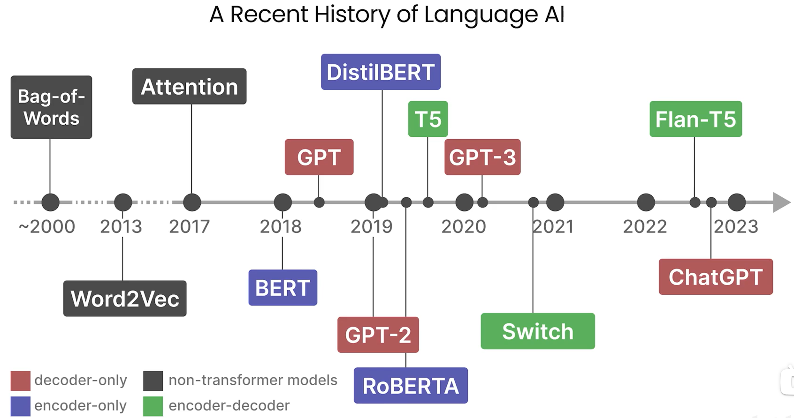
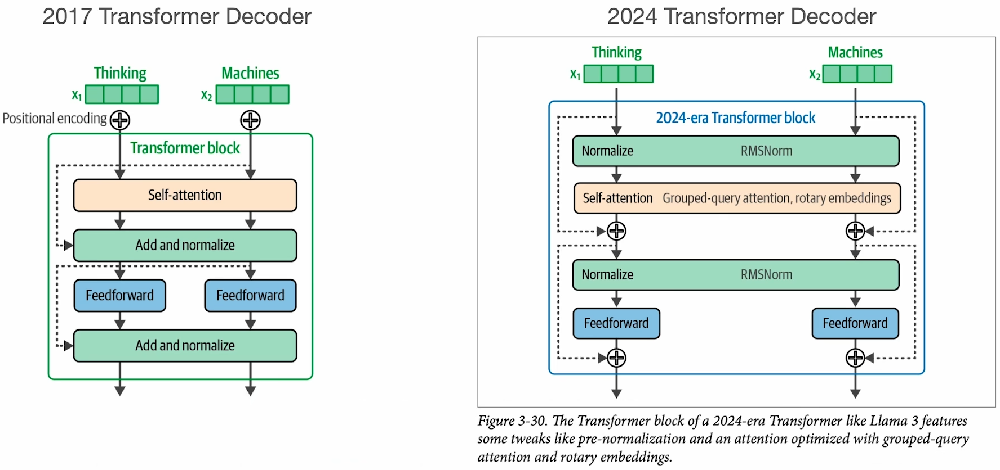
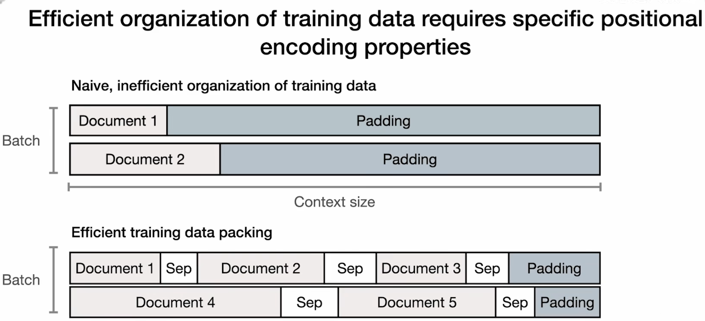

参考资料：[Andrew Ng's Course - How Transformer LLMs Work](https://www.deeplearning.ai/courses/how-transformer-llms-work)

## 前言

- Transformer架构的宏观理解：输入一个提示并输出对该提示的回应

## Bag-of-Words

- A Recent History of Language AI
    
- 词袋(Bag-of-Words)：输入中token在Vocabulary中出现的频率，同时顺序也很重要，表示出来的向量即为Vector Representation

## Word2Vec

- 背景：One-Hot编码不能表示词之间的相似性
- Word2Vec通过在大量文本数据上进行训练来学习单词的语义表示
- 这是一个Representation Model，通过将sentence中的tokens转化为d维的向量，根据token与token之间的相似度来调整token的向量表示

## Encoding and Decoding Context with Attention

- 背景：Word2Vec创造的是静态嵌入，例如对于bank这个词在不同语境下有相同的嵌入表示
- Seq2Seq是一种自回归模型，即通过前面的输入和当前的输出作为下一时刻的输入
- Attention选择性地确定在特定句子中哪些单词最重要，解码器使用注意力机制来查看整个序列
  - 效果更好，因为现在使用每个token的嵌入来看整个序列，而不是较小且更有限的Context Embedding

## Transformers

- Transformer由堆叠的编码器和解码器块组成
- Encoder：在表示文本并且在生成嵌入向量方面表现出色
  - 输入随机化的嵌入向量（并非Word2Vec）
  - Self-Attention是仅关注输入的注意力（自己查自己），处理这些嵌入向量并更新它们，这些更新后的嵌入向量包含更多的上下文信息
  - 传递到Feed-forward Neural Network
  - 最终创建上下文化的词元或词嵌入
- Decoder
  - 取先前生成的词并将其传递到掩码自注意力（确保不看到后面，只依靠已预测的部分），类似于编码器来处理这些嵌入向量
  - 中间嵌入向量生成后与编码器的嵌入向量一起传递到另一个注意力网络
  - 这个输出结果传递到神经网络并最终生成序列中的下一个词
- Representation Models: Bidirectional Encoder Representation from Transformers(BERT)
  - 专注于representing language和generating contextualized word embeddings
  - 微调后可用于Classification, Named Entity Recognition, Paraphrase Identification
- Generative Models: GPT
  - 只有Decoder，最后一个Transformer Decoder块再次使用掩码自注意力机制然后将其传递给一个神经网络
- Representation Models和Generative Models的共同点是Context Length，即原始query连同之前生成的token代表当前的上下文长度，这是模型当前正在处理的token数量
- 最大上下文长度也包括随着更新当前上下文长度而生成的token

## Tokenizers

- 过程：对于一个Input序列，将其分为tokens，然后将其转化为数值表示embeddings，这些嵌入是静态的，每个嵌入的创建独立于所有其他嵌入和标记，这些嵌入由大型语言模型处理并转换为上下文嵌入，这些嵌入仍然是每个token对应一个向量，但是已被处理，使得所有其他标记都被考虑在内，这些嵌入可以是模型的输出，也可以被模型使用以创建输出。对于生成模型来说，这可以是另一个token。

## Architectual Overview

- Transformer LLM 由 3 个主要组件组成：
  - Tokenizer
  - Stack of Transformer Blocks: n Transformer Block
  - LM Head: 返回的是词汇表中每个token的概率评分，实质就是一个线性层加一个softmax层
- 解码策略：
  - 贪婪解码：将temperature设为0，选择最高评分的token
  - Top-p：temperature大于0
- 并行化：如果input的上下文长度是16000个tokens，那么GPU可以同时处理16000个tokens
- 解码器输出最后一个token的结果，然后把最后一个放到输入中，可以缓存之前的计算结果(KV caching)

## The Transformer Block

- 组成部分
  - Self-Attention：允许模型关注之前的标记并在理解当前标记时结合上下文
    - 例如：对于The dog chased the llama because it这个prompt，模型需要理解句中的it指的到底是什么（这叫做 co-reference resolution）
  - Feed Forward Neural Network：信息和统计数据的存储【我认为这表示的是模型如何理解文本】
- Self-Attention做了两件事：
  - 相关性评分(relevance scoring)：为每个输入token与我们当前处理的token的相关性分配一个分数
  - 将相关信息合并到表示中(Combining information)

## Self-Attention

- Self-Attention Head
  - 直觉上：将当前token相关的查询向量(1, embedding_size)与表示所有先前token的键向量(embedding_size, input_token_size)相乘，得到每个token的相关性分数(1, input_token_size)
  - 再将相关性分数与values相乘（也是每个token的embedding向量），得到加权的values，最后将它们相加
- Multi-Head Attention
  - 每个Self-Attention Head并行计算，它们分配给各种向量的注意力是不同的
- multi-query attention
  - 让每个自注意力头共享相同的键矩阵和值矩阵
  - 进化版：
    - 分组查询注意力，即使用多组键值对
    - 稀疏注意力(sparse attention)：不能回溯到所有历史token，仅限最后n个token和每隔几个取一个token（分为strided和fixed）
    - 环形注意力(ring attention)

## Recent Improvements

- 2017 与 2024 Transformer 架构对比
  - 
- 训练文本组织方法
  - 
- 旋转嵌入(Rotary Embeddings, RoPE)
  - 在自注意力的这一步添加了位置信息，在其中的相关性评分之前，也就是加到query和key中
- 专家混合模型(Mixture of Experts, MoE)
  - 使用多个子模型来提高LLM质量
  - 在每一层都有多个子神经网络（专家），然后在每一层都有一个路由器来决定哪些专家应该处理哪个token
  - 参考资料：A Visual Guide to Mixture of Experts
  - 不要将每个专家视为一个单一的组件，每一层都有自己的一组专家
  - 这些专家并不是专门针对特定领域的，比如心理学专家或生物学专家，这些专家可能更倾向专注于特定类型的token并如何最好地处理它们，例如标点、形容词、动词等等
  - 每一层都会路由到该层的适当的专家，有的时候每一层会路由到两个不同的专家并将两者的信息合并回来（加权平均）
  - 是FFN的一部分，即MoE Layer

## Mixture of Experts (MoE)

- A Dense Neural Network：FFN采用Dense Model，网络的所有参数都被激活并至少在某种程度上使用
- MoE：对于进入原来FFN的输入，将其分配给某一个或某几个专家（每个expert都是一个FFN）处理，其他专家不激活，也就是激活部分参数，这是稀疏模型(Sparse Model)
  - 路由器Router本身也是一个FFN，但要小得多
  - 参数来源：嵌入层、掩码自注意力层、路由器、专家们、输出嵌入
  - 由于有多个专家，加载模型所需的内存量相对较高，但在推理过程中由于并不是所有专家都被使用，所以相对较低
  - 非Transformer模型也可以有Mo-Layer，例如状态空间模型Mamba和Jamba作为Transformer模型的替代方案也有Mo变体
